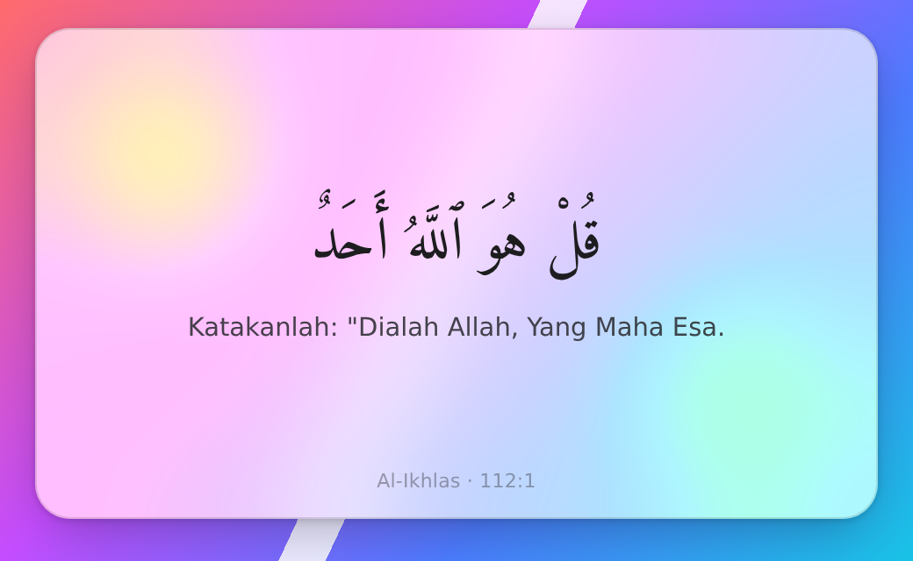
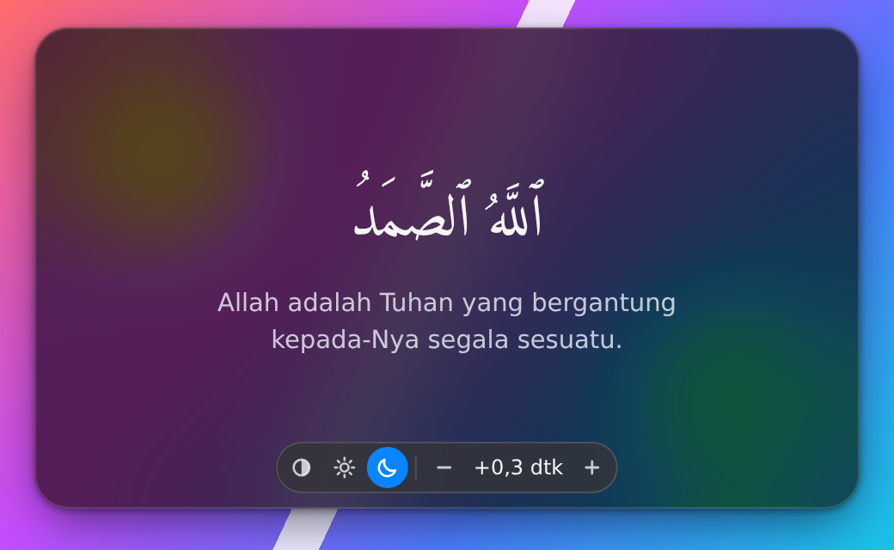

# Simak

**Simak** (dari kata "simak": mendengarkan dengan penuh perhatian) adalah widget desktop kecil yang menampilkan ayat Al-Qur'an beserta terjemahan Indonesia yang sedang dibacakan pada trek di aplikasi Spotify. Nama pencarian: *Simak Ayat*. Tagline: *Ayat yang sedang dibacakan*.

> **Status: pra-rilis.** Belum ada unduhan. Installer Linux akan tersedia lebih dulu di halaman [Releases](https://github.com/ArielSulton/quran-widget/releases) setelah rilis pertama diterbitkan; build macOS dan Windows menyusul setelah diverifikasi di mesin asli.

## Tampilan

| Terang | Gelap, dengan kontrol |
|---|---|
|  |  |

Gambar di atas dibuat dari mode pratinjau pengembangan di browser (dengan latar warna-warni agar efek kaca terlihat), bukan tangkapan layar aplikasi asli. Gambar disimpan di `docs/images/`.

## Cara kerja

1. Simak membaca trek yang sedang diputar di aplikasi desktop Spotify lewat kontrol media bawaan sistem operasi (MPRIS di Linux, AppleScript/osascript di macOS, SMTC di Windows; lihat "Batasan" untuk status verifikasinya).
2. Judul trek dicocokkan ke nama surah.
3. Posisi pemutaran dicari di tabel waktu ayat yang sudah dihitung sebelumnya (`data/timing/`), sehingga ayat berganti ketika qari pindah ayat. Tabel ini sudah disertakan di repositori: 35 surah Juz 30.
4. Widget menampilkan teks Arab dan terjemahan Kementerian Agama RI.

Simak tidak memakai API atau SDK Spotify, tidak meminta login, dan tidak memutar atau menyimpan audio apa pun.

## Cara pakai

1. Jalankan Simak.
2. Di aplikasi **desktop** Spotify, putar trek surah Juz 30 oleh Yasser Al-Dosari.
3. Widget mengikuti: ayat tampil dan berganti mengikuti bacaan. Saat dijeda, widget diam di ayat terakhir.

Arahkan kursor ke widget (atau fokuskan dengan papan ketik) untuk memunculkan kontrol:

- **Tema:** Otomatis (mengikuti sistem), Terang, atau Gelap. Pilihan disimpan.
- **Geser sinkron:** menggeser waktu ayat relatif terhadap suara, dari -2,0 sampai +2,0 detik. Tombol `-` / `+` melangkah 0,1 detik; tahan **Shift** untuk langkah 1 detik. Dari papan ketik: `[` mengurangi dan `]` menambah (juga dengan Shift). Klik dua kali pada nilai (atau Enter) untuk kembali ke 0. Tambah nilainya jika ayat muncul lebih cepat dari suara, kurangi jika terlambat. Pilihan disimpan.
- **Ubah ukuran:** pegangan kecil (tiga garis miring) di pojok kanan bawah kartu muncul bersama kontrol. Seret untuk mengubah ukuran jendela. Dari papan ketik: fokuskan pegangan dengan Tab, lalu panah mengubah ukuran 10 px (dengan **Shift**: 50 px). Ukuran minimum 430 x 270 (dijaga oleh jendela); bawaan 520 x 320. Batas atas 2000 x 1200 hanya berlaku untuk ubah ukuran lewat papan ketik dan untuk ukuran yang dipulihkan, tidak untuk seret dengan mouse. Keduanya juga dibatasi ke ukuran monitor (dikurangi sisa 80 x 120 px untuk panel).
- **Ukuran tersimpan:** ukuran jendela diingat dan dipulihkan saat Simak dibuka lagi; ukuran yang lebih besar dari monitor saat ini diperkecil agar muat. Posisi jendela tidak disimpan.
- **Font ikut membesar:** semakin besar jendela, teks Arab (sampai 1,6 kali pada jendela sekitar 960 x 560), terjemahan, dan footer ikut membesar secara proporsional. Pada jendela kecil dan ayat panjang, font Arab mengecil bertahap agar ayat tetap muat tanpa terpotong.

Geser sinkron perlu karena posisi pemutaran yang dilaporkan Spotify bisa berbeda dari audio yang terdengar (lihat di bawah).

### Cara menyetel sinkron

1. Putar satu surah dan perhatikan saat qari berpindah ayat.
2. Jika ayat berikutnya muncul **lebih cepat** dari suara, tekan `]` (tambah). Jika **terlambat**, tekan `[` (kurangi). Tahan Shift untuk langkah 1 detik, lepas Shift untuk langkah halus 0,1 detik.
3. Ulangi di beberapa pergantian ayat sampai pas. Nilai disimpan; klik dua kali pada nilai untuk kembali ke 0.

## Batasan (jujur)

- **Hanya Juz 30 pada v1.** Surah lain belum ada.
- **35 dari 37 surah Juz 30.** Surah 101 (Al-Qari'ah) dan 104 (Al-Humazah) dikecualikan karena trek Spotify-nya adalah rekaman yang berbeda dari rekaman rujukan, sehingga tabel waktunya tidak berlaku.
- **Ketelitian tabel waktu tidak seragam.** `data/timing/_summary.json` mencatat tingkat keyakinan per surah (17 tinggi, 10 sedang, 8 rendah) dan batas ayat yang ditandai untuk didengarkan ulang. Penyelarasan trek Spotify terhadap rekaman rujukan membawa ketidakpastian sekitar ±1 detik pada sebagian surah, dan satu kasus (surah 78, awal trek) belum dipastikan dengan didengarkan.
- **Sinkron tidak sempurna.** Posisi yang dilaporkan Spotify bisa bergeser sekitar ±1 detik dari audio pada sebagian sistem. Gunakan geser sinkron untuk menyesuaikan.
- **Baru Linux yang terverifikasi.** Sumber pemutaran macOS (osascript) dan Windows (SMTC) sudah diimplementasikan, tetapi belum diverifikasi di mesin asli: baru terbukti kompilasi dan lulus tes murni di CI. Karena itu build macOS/Windows bersifat eksperimental dan tidak ikut rilis biasa.
- **Blur latar belum diverifikasi.** Blur tingkat sistem hanya dirancang untuk macOS (belum diuji). Di Linux tidak ada blur di belakang jendela, dan di Windows belum diverifikasi; tanpa blur, kartu memakai isian yang lebih pekat agar teks tetap terbaca di atas wallpaper apa pun, jadi tampilannya tidak semirip kaca seperti pada gambar di atas.
- **Ukuran jendela minimum 430 x 270.** Lebih kecil dari itu tidak didukung: ayat panjang tidak lagi muat tanpa font yang terlalu kecil atau teksnya menyentuh pil kontrol. Pada ukuran minimum, bawaan, dan dua ukuran lebih besar, seluruh 564 ayat Juz 30 diperiksa muat tanpa terpotong dan tanpa bertabrakan dengan pil kontrol, pegangan, atau footer (`node scripts/layout-sweep.mjs`, lihat bawah).
- **Linux: compositing WebKit dimatikan.** Di jendela transparan pada WebKitGTK, sisa huruf atau kotak dari ayat sebelumnya bisa tertinggal di tepi kartu setelah ayat berganti (dipastikan di X11/GNOME, Intel/Mesa, WebKitGTK 2.50). Karena itu di Linux Simak menyetel `WEBKIT_DISABLE_COMPOSITING_MODE=1` sebelum WebKit dimulai. Kompromi: compositing GPU untuk tampilan web dimatikan, sehingga animasi bisa kurang mulus dan `backdrop-filter` tidak bisa diandalkan (Linux memang sudah memakai kartu solid tanpa blur). Bila variabel itu sudah Anda setel sendiri, nilai Anda dihormati. Untuk memilih keluar: `WEBKIT_DISABLE_COMPOSITING_MODE=0 simak` (nama biner paket terpasang diatur lewat `mainBinaryName` di `tauri.conf.json`; build pengembangan memakai nama cargo `quran-widget`). Efek pada mesin lain belum diverifikasi.
- Hanya Spotify di komputer yang sama; tidak untuk Spotify di HP atau perangkat lain.

## Membangun dari sumber

Prasyarat umum: Node.js 22 dan toolchain Rust >= 1.88 (`rustup`).

Linux (Debian/Ubuntu), paket sistem yang dibutuhkan:

```bash
sudo apt install build-essential pkg-config libwebkit2gtk-4.1-dev libgtk-3-dev \
  libayatana-appindicator3-dev librsvg2-dev libdbus-1-dev patchelf
```

Lalu:

```bash
npm install
npm run tauri dev      # jalankan dalam mode pengembangan
npm run tauri build    # bangun installer untuk OS ini
```

Tes: `npx vitest run` (antarmuka) dan `cd src-tauri && cargo test -p quran-widget` (inti Rust). Pengembang yang memakai Rust 1.88 dan memperbarui `Cargo.lock` sebaiknya menyetel `CARGO_RESOLVER_INCOMPATIBLE_RUST_VERSIONS=fallback` agar dependensi yang dipilih cocok dengan versi Rust tersebut.

Pratinjau antarmuka tanpa Tauri (di browser): `npm run dev`, lalu buka mis. `http://localhost:1420/?preview=ayah&surah=112&ayah=2&theme=dark&controls=1&backdrop=1`. Parameter: `preview=ayah|waiting|intro`, `surah`, `ayah`, `theme=auto|light|dark`, `sync` (ms), `controls=1` (memunculkan pil kontrol dan pegangan ubah ukuran), `backdrop=1`, `material=native|css|solid`. Di browser, pegangan ubah ukuran hanya tampil dan tidak bereaksi.

Sapuan tata letak (opsional, tanpa dependensi npm; butuh `google-chrome` dan Node 22): `node scripts/layout-sweep.mjs` merender ke-564 ayat pada ukuran minimum (dibaca dari `tauri.conf.json`), 520x320, 720x420, dan 960x560 di Chrome tanpa kepala dengan kontrol dipaksa terlihat, mencetak jumlah masalah (ayat terpotong, atau baris teks yang menyentuh pil kontrol, pegangan, atau footer), dan gagal (kode keluar 1) bila ada masalah pada salah satu ukuran itu. Skrip membersihkan server vite, Chrome, dan profil sementaranya sendiri.

Uji jalur jendela tanpa aplikasi asli (opsional): `node scripts/e2e-window-mock.mjs` memuat halaman dengan Tauri palsu yang mencatat perintah, lalu memeriksa pemulihan dan pembatasan ukuran ke monitor, seret ubah ukuran, panah papan ketik, dan penyimpanan ukuran. Ini bukan pengganti uji pada jendela sungguhan. Opsi: `--sizes`, `--assert`, `--shots DIR` (simpan PNG), `--theme dark`, `--url` (pakai server yang sudah berjalan; tanpa itu skrip menyalakan vite di port acak).

### Ikon

Master ikon: `src-tauri/icons/source/simak-icon.svg` (huruf sin dalam bentuk path, tanpa ketergantungan font; dibuat dengan `scripts/gen-icon-svg.py`). Set platform dibuat dengan `npx tauri icon src-tauri/icons/source/simak-icon.png` dari PNG 1024 px hasil render SVG; hanya berkas yang dipakai `tauri.conf.json` yang disimpan.

## Struktur repositori

```
src/            antarmuka (TypeScript + Vite): tampilan, tema, geser sinkron
src-tauri/      aplikasi Tauri (Rust): sumber pemutaran, mesin ayat, jendela
data/quran/     teks Arab dan terjemahan Juz 30 (JSON) + catatan lisensi
data/timing/    tabel waktu ayat per surah (dihasilkan oleh tools/)
tools/          alat Python untuk membangun dan memeriksa data waktu
scripts/        skrip bantu (ikon, daftar lisensi dependensi, sapuan tata letak)
docs/           gambar, spesifikasi, dan rencana
```

## Menguji di macOS atau Windows

Jika Anda punya Mac atau PC Windows dan bersedia membantu memverifikasi: putar sebuah trek Juz 30 di Spotify tanpa seek atau jeda, lalu jalankan

```bash
cd src-tauri && cargo run --release --example accuracy_probe -- --seconds 60
```

Alat ini hanya membaca posisi pemutaran (tidak mengirim perintah apa pun) dan mencetak ringkasan deviasi. Di macOS, izinkan dialog izin kontrol Spotify saat pertama kali dan jalankan ulang. Kirim seluruh keluaran (terutama blok "RINGKASAN"), beserta nama dan versi OS, lewat [GitHub Issues](https://github.com/ArielSulton/quran-widget/issues).

## Data waktu ayat

Tabel di `data/timing/` dihitung di sisi pengembang dengan alat Python di `tools/` (lihat `tools/requirements.txt`; perlu model dan jaringan, jadi tidak dijalankan di CI). Tabel yang sudah jadi (`data/timing/*.json`, 35 surah) dan ringkasan pembuatannya (`_summary.json`, memuat keyakinan per surah dan surah yang dikecualikan) ikut dikomit. Aplikasi hanya membaca tabel jadi; tidak ada audio yang disertakan.

## Lisensi

Lisensi proyek belum dipilih. Selama belum ada berkas lisensi, secara hukum berlaku "hak cipta dilindungi" (*all rights reserved*) untuk kode di repositori publik ini.

Pilihan lisensi dibatasi satu hal: terjemahan Indonesia (Kementerian Agama RI, lewat Tanzil) hanya boleh dipakai untuk tujuan **nonkomersial**. Karena itu Simak harus tetap gratis, tanpa iklan, dan tanpa monetisasi, kecuali ada izin dari penerjemah/penerbit. Teks Arab (Tanzil, CC BY 3.0), font Amiri Quran yang disertakan (SIL OFL 1.1, tanpa perubahan; teks lisensi di `src/assets/fonts/OFL.txt`), sumber audio rujukan, dan dependensi pihak ketiga dijelaskan di [THIRD-PARTY-NOTICES.md](THIRD-PARTY-NOTICES.md); atribusi data Qur'an juga ada di [data/quran/NOTICE.md](data/quran/NOTICE.md).

## Tidak berafiliasi

Simak tidak berafiliasi dengan, disponsori, atau didukung oleh Spotify AB. Spotify adalah merek dagang Spotify AB. Simak tidak memakai API atau SDK Spotify dan tidak menyimpan atau membagikan audio apa pun.

## Masukan

Laporan masalah dan saran: [GitHub Issues](https://github.com/ArielSulton/quran-widget/issues).
